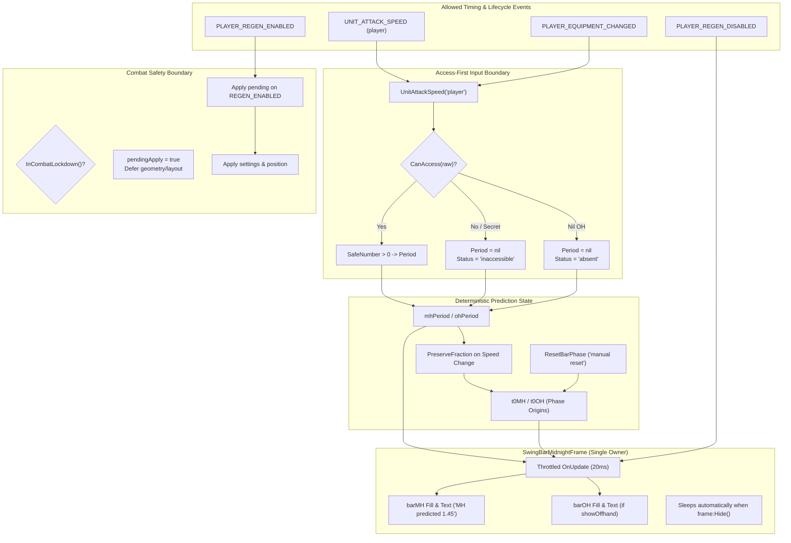

# Pull Request / Audit Report: SwingBarMidnight — Retail 12.1 (Interface 120100) Compliance & Modernization

## Executive Summary

| Item | Details |
| :--- | :--- |
| **Addon Name** | **SwingBarMidnight** |
| **Addon Directory** | `_Addons/SwingBarMidnight` |
| **Remote Repository** | `github-swing-bar-midnight` (`https://github.com/UnknownAlienHuman/swing-bar-midnight.git`) |
| **Target Client** | World of Warcraft: Midnight / Retail 12.1 (`Interface: 120100`, Verified Build `12.1.0.69497`) |
| **Addon Purpose** | Accessible, deterministic predicted melee cadence display based on `UnitAttackSpeed("player")`. |
| **Audit Date** | 2026-09-08 |
| **Local Status** | Obsolete **v0.8.1** baseline (`Interface: 120000`, 10 files). Contains severe design flaws: compares SecretValues directly with numbers causing script crashes, hardcodes a fake 2.0s attack speed fallback, registers forbidden/deprecated `SPELL_ACTIVATION_OVERLAY_*` (WOWUI-2026-012) and `UNIT_AURA` events, installs an insecure `UseAction` hook creating combat taint hazards, scans 180 action slots and macros, polls `C_Spell.IsSpellInRange` in an `OnUpdate` loop, uses unphysical harmonic dual-wield math, runs an unthrottled permanent `OnUpdate` loop on a separate hidden frame (wasting CPU), and lacks proper SavedVariables schema sanitization (RT-AUDIT-001/002). |
| **Remote Status** | Modernized **v0.9.0** architecture (`Interface: 120100`, Build `12.1.0.69497`, 10 files). Completely eliminates all aura/glow/action/macro/range hooks and heuristics. Adopts an honest, transparent predicted cadence model. Implements `CanAccess` guards against SecretValues before any comparison or arithmetic. Eliminates fake fallbacks. Restores clean separate MH/OH dual-wield tracking. Attaches throttled `OnUpdate` directly to top-level frame so it sleeps when hidden. Modernizes Settings to canonical vertical Blizzard Settings API. Implements combat-deferred settings application. Backed by automated mock regression test suite (`tests/test_predicted_cadence_12_1.lua`). |

---

## Remote Comparison (`git diff HEAD:_Addons/SwingBarMidnight github-swing-bar-midnight/main`)

Comparing local `HEAD:_Addons/SwingBarMidnight` with `remotes/github-swing-bar-midnight/main` reveals a complete architectural refactor:

```text
 AGENT_GUIDE.md                        |  174 ++++-
 ARCHITECTURE.md                       |   93 ++-
 CODE_GRAPH.md                         |   34 +-
 CODE_INDEX.md                         |   26 +-
 README.md                             |   82 ++-
 SwingBarMidnight.toc                  |    7 +-
 core.lua                              | 1231 +++++++++++----------------------
 options.lua                           |  725 +++----------------
 tests/test_predicted_cadence_12_1.lua |  170 +++++
 todo.md                               |    5 -
 10 files changed, 1018 insertions(+), 1529 deletions(-)
```

### Upstream Evolution Breakdown

The upstream repository underwent a focused overhaul specifically targeting Retail 12.1:

1. **`9e1f105` & `e225fdc`: Heuristic Anchor Purge & Honest Cadence Model**
   - Eliminated all unprovable pseudo-anchors: `UNIT_AURA`, `AuraUtil.FindAuraBySpellId`, `SPELL_ACTIVATION_OVERLAY_*`, action-slot scans, macro queries, `hooksecurefunc("UseAction", ...)`, and range polling.
   - Reframed product claim: the addon is an honest **predicted cadence indicator**, not a hit parser, because Retail 12.1 does not provide a legal, unambiguous hit-event timestamp for melee auto-attacks without combat log or restricted events.
2. **`0199c77` & `507d7b0`: Retail 12.1 Interface & SecretValue Safety**
   - Updated TOC Interface to `120100`, version to `0.9.0`, with `## X-Verified-Build: 12.1.0.69497`.
   - Introduced `CanAccess` / `SafeNumber` wrappers to prevent Lua comparison exceptions when `UnitAttackSpeed` returns restricted `SecretValue` instances.
   - Eliminated the fake `2.0s` fallback period; inaccessible speeds are explicitly surfaced as `"inaccessible"`.
3. **`9309f34` & `9540766`: Performance & Combat Lockdown Hardening**
   - Attached the visual `OnUpdate` directly to the top-level bar frame so it stops firing when hidden (e.g. outside combat when `showOnlyInCombat = true`).
   - Cleaned up drag registrations (`frame:RegisterForDrag()` with no arguments when locked, fixing nil-argument errors).
   - Enforced out-of-combat deferral for settings and frame resizing (`state.pendingApply = true`, applied on `PLAYER_REGEN_ENABLED`).
4. **`1c2f3ff` & `f0e7f9e`: Automated Test Suite & Validation Matrix**
   - Added `tests/test_predicted_cadence_12_1.lua` covering inaccessible values, accessible single/dual-wield transitions, combat deferral, manual phase resets, and stale period clearing.
   - Updated `AGENT_GUIDE.md`, `ARCHITECTURE.md`, `CODE_GRAPH.md`, and `CODE_INDEX.md` to reflect strict Retail 12.1 engineering requirements.

---

## Detailed Audit Findings against Retail 12.1 & KB Standards

### 1. SecretValue & `UnitAttackSpeed` Comparison Crash (Critical Severity)
- **Local State** (`core.lua:136-149`):
  ```lua
  local function GetAttackSpeeds()
    local mh, oh
    if type(GetSwingSpeeds) == "function" then
      mh, oh = GetSwingSpeeds()
    end
    mh, oh = mh or 0, oh or 0
    if mh <= 0 then
      local u1, u2 = UnitAttackSpeed("player")
      mh, oh = u1 or 0, u2 or 0
    end
    if mh <= 0 then mh = 2.0 end
    if not oh or oh <= 0 then oh = 0 end
    return mh, oh
  end
  ```
- **Violations**:
  - In Retail 12.1 / Midnight, `UnitAttackSpeed("player")` can return `SecretValue` tokens under combat lockdown or restricted contexts.
  - Comparing a `SecretValue` with a number (`mh <= 0` or `oh <= 0`) throws a fatal Lua error (`attempt to compare secret with number`), causing script failure during combat.
  - Hardcoded fake fallback (`mh = 2.0`): substituting an arbitrary 2.0s swing timer misleads the player and masks access failures.
- **Upstream 12.1 Compliant Implementation** (`core.lua:67-123`):
  ```lua
  local function CanAccess(value)
    if type(canaccessvalue) == "function" then
      local ok, accessible = pcall(canaccessvalue, value)
      return ok and accessible == true
    end
    if type(issecretvalue) == "function" then
      local ok, secret = pcall(issecretvalue, value)
      return ok and secret ~= true
    end
    return true
  end

  local function SafeNumber(value)
    if not CanAccess(value) or type(value) ~= "number" or value ~= value then return nil end
    return value
  end

  local function ReadAttackSpeeds()
    if type(UnitAttackSpeed) ~= "function" then
      return nil, nil, "api unavailable", "api unavailable"
    end
    local ok, mhRaw, ohRaw = pcall(UnitAttackSpeed, "player")
    if not ok then return nil, nil, "api error", "api error" end

    local mh, mhStatus
    if CanAccess(mhRaw) then
      mh = SafeNumber(mhRaw)
      if mh and mh > 0 then mhStatus = "accessible" else mh, mhStatus = nil, "missing" end
    else
      mhStatus = "inaccessible"
    end

    local oh, ohStatus
    if CanAccess(ohRaw) then
      if ohRaw == nil then
        ohStatus = "absent"
      else
        oh = SafeNumber(ohRaw)
        if oh and oh > 0 then ohStatus = "accessible" else oh, ohStatus = nil, "absent" end
      end
    else
      ohStatus = "inaccessible"
    end
    return mh, oh, mhStatus, ohStatus
  end
  ```
  Inaccessible speeds never reach arithmetic operations; the bar gracefully displays `"inaccessible"` text without throwing errors.

---

### 2. Taint Hazard: Global `UseAction` Secure Hook & Action Bar Scanning (Critical Severity)
- **Local State** (`core.lua:683-726`):
  ```lua
  local watchedSlots = {}
  local function BuildWatchedSlots()
    for slot = 1, 180 do
      local t, id = GetActionInfo(slot) ...
    end
  end
  if DB.useActionFallback then
    hooksecurefunc("UseAction", function(slot)
      if slot and watchedSlots[slot] then
        SuppressNow("useaction", slot)
      end
    end)
  end
  ```
- **Violations**:
  - Hooking `UseAction` directly intercepts protected button clicks. In Retail 12.1, hooking `UseAction` taints the execution call stack during action button execution, which can break spell casting, item usage, and macro evaluation during combat lockdown.
  - Scanning 180 action slots and reading macro info (`GetMacroSpell`) creates unnecessary execution spikes and memory churn on `ACTIONBAR_SLOT_CHANGED` and `UPDATE_MACROS`.
- **Upstream 12.1 Compliant Implementation**:
  - Completely eradicated `hooksecurefunc("UseAction", ...)` and all action slot/macro scanning. Zero action bar taint risk.

---

### 3. Deprecated Spell Activation Overlays (WOWUI-2026-012) (High Severity)
- **Local State** (`core.lua:527-547, 862-867, 891-894`):
  - Registers `SPELL_ACTIVATION_OVERLAY_GLOW_SHOW`, `SPELL_ACTIVATION_OVERLAY_GLOW_HIDE`, `SPELL_ACTIVATION_OVERLAY_SHOW`, `SPELL_ACTIVATION_OVERLAY_HIDE`.
  - Attempts to detect button glow rising edges to anchor swing cadence.
- **Violations**:
  - In Retail 12.1, Blizzard overhauled spell activation overlays (**WOWUI-2026-012**). These legacy events are either restricted, deprecated, or behave asynchronously.
  - Procs (e.g. Killing Machine on Obliterate) do not indicate a swing hit; they can trigger from Runic Power spenders or other abilities.
- **Upstream 12.1 Compliant Implementation**:
  - Removed all overlay glow listeners. Cadence is kept purely deterministic and uncoupled from overlay state.

---

### 4. UnitAura Deprecation & Unbounded Scanning (High Severity)
- **Local State** (`core.lua:117-126, 549-583, 870-874, 896`):
  - Registers `UNIT_AURA` for the player.
  - Uses `AuraUtil.FindAuraBySpellId(spellId, "player", "HELPFUL")` in a polling/event loop.
  - Contains class-specific hardcoded spell lists (`SUPPRESS_CAST_SPELLS` for Death Knight: Frost Strike, Glacial Advance, Howling Blast, Empower Rune Weapon) to patch up false triggers.
- **Violations**:
  - In Retail 12.1, `AuraUtil.FindAuraBySpellId` is deprecated in favor of managed `C_UnitAuras` / `AuraContainer` APIs, and raw `UNIT_AURA` handling in combat is restricted and prone to `SecretValue` taint.
  - Hardcoding Death Knight abilities in a general melee swing timer addon creates brittle, incomplete heuristics.
- **Upstream 12.1 Compliant Implementation**:
  - Removed `UNIT_AURA`, `AuraUtil`, and all class-specific spell suppression lists.

---

### 5. Range Gating in Hot-Path `OnUpdate` (Medium Severity)
- **Local State** (`core.lua:620-661, 747-752`):
  - Calls `C_Spell.IsSpellInRange(6603, "target")` every 0.10 seconds within the `OnUpdate` loop and on `PLAYER_TARGET_CHANGED`.
- **Violations**:
  - Auto Attack (spell ID 6603) range queries are notoriously unreliable across modern client versions and can return `nil` or fail depending on vehicle/target states.
  - Running range checks during the swing bar render loop adds unnecessary overhead and jitter.
- **Upstream 12.1 Compliant Implementation**:
  - Eliminated range gating and target change polling. Cadence runs deterministically based on weapon speed.

---

### 6. Unphysical Harmonic Dual-Wield Model (High Severity)
- **Local State** (`core.lua:198-208`):
  ```lua
  if state.hasOffhand then
    local rate = (1.0 / mh) + (1.0 / oh)
    state.periodCombined = (1.0 / rate)
  end
  ```
- **Violations**:
  - Modern dual-wield mechanics do not fire on a harmonic combined frequency $T = \frac{1}{\frac{1}{T_{MH}} + \frac{1}{T_{OH}}}$.
  - Merging two independent weapons into a single artificial bar that ticks at a blended rate produces confusing, inaccurate visual feedback.
- **Upstream 12.1 Compliant Implementation**:
  - Implements clean, independent MH and OH prediction bars when `showOffhand` is enabled.
  - If offhand is not equipped or `showOffhand` is disabled, displays a single dedicated MH prediction bar.

---

### 7. RT-AUDIT-002: Single Runtime Owner & Hidden Frame CPU Wastage (High Severity)
- **Local State** (`core.lua:729-787`):
  - Created a separate anonymous frame `updater = CreateFrame("Frame")` with an `OnUpdate` script.
  - The updater frame was never hidden, even when the UI was inactive:
    ```lua
    updater:SetScript("OnUpdate", function(_, elapsed)
      if not frame then return end
      if not ShouldShow() then
        if frame:IsShown() then frame:Hide() end
        return -- Frame is hidden, but updater continues running every frame!
      end
    ...
    ```
  - This executed 60–144+ times per second in the background during gameplay even outside combat or when disabled.
- **Upstream 12.1 Compliant Implementation**:
  - Single runtime owner: `frame:SetScript("OnUpdate", ...)` is attached directly to `SwingBarMidnightFrame`.
  - When `frame:Hide()` is invoked, the WoW engine automatically suspends execution of `OnUpdate`. Zero CPU overhead when inactive.

---

### 8. RT-AUDIT-001: SavedVariables Default Mutation & Schema V2 (Medium Severity)
- **Local State** (`core.lua:14-23, 86`):
  - Used generic `CopyDefaults(DB, defaults)` without type-checking or schema versioning.
  - Left outdated/invalid fields persisted in SavedVariables across updates.
- **Upstream 12.1 Compliant Implementation** (`core.lua:53-102`):
  - Sets `ns.DB_VERSION = 2`.
  - Implements `SanitizeDB()`:
    - Merges `DEFAULTS` without inserting table references.
    - Validates types with `SafeBoolean`, `SafeNumber`, and `SafeString`.
    - Clamps dimensions (`width: 120-900`, `height: 8-60`, `scale: 0.6-3.0`, `fontSize: 6-40`).
    - Explicitly sets retired 0.8.x legacy fields (`anchorOnGlow`, `rangeCheck`, `useActionFallback`, `debug`, etc.) to `nil` to clean up the user's `WTF` SavedVariables file.

---

### 9. Combat Lockdown Safety & Drag Registration (Medium Severity)
- **Local State** (`core.lua:347-358, 380-422, 920-936`):
  - `ns.ApplySettings()` mutated frame points, dimensions, and mouse interactivity without checking `InCombatLockdown()`.
  - When locked, called `frame:RegisterForDrag()` with no arguments, but left the resizer button (`resizer:RegisterForDrag("LeftButton")`) permanently enabled.
- **Upstream 12.1 Compliant Implementation**:
  - `ns.ApplySettings()` checks `InCombatLockdown()`. If locked down, sets `state.pendingApply = true` and defers all frame geometry changes.
  - `PLAYER_REGEN_ENABLED` safely applies deferred settings upon leaving combat.
  - `SavePosition()` aborts if `InCombatLockdown()`.
  - `SetLocked(locked)` disables both main frame and resizer dragging safely.

---

### 10. Options Panel Modernization (Medium Severity)
- **Local State** (`options.lua:1-639`):
  - 639 lines of legacy UI code attempting to build a custom scrollable panel with `OptionsSliderTemplate`, `UICheckButtonTemplate`, `InputBoxTemplate`, and fallback to `InterfaceOptions_AddCategory`.
- **Upstream 12.1 Compliant Implementation** (`options.lua:1-99`):
  - 99 lines of clean modern code using the Retail vertical Settings API:
    - `Settings.RegisterVerticalLayoutCategory("SwingBarMidnight")`
    - `Settings.RegisterAddOnSetting(...)`
    - `Settings.CreateCheckbox(...)`
    - `Settings.CreateSlider(...)`
    - `Settings.RegisterAddOnCategory(...)`
    - Seamlessly integrates into the Blizzard Options interface.

---

## Architectural Specification (Retail 12.1 Model)



---

## Automated Test Suite Coverage

The upstream repository includes `tests/test_predicted_cadence_12_1.lua`, which executes against a full Blizzard frame/event mock. The suite validates:

1. **SecretValue Inaccessibility Rejection**: Simulates un-inspectable `SecretValue` speed tokens. Confirms `mhPeriod = nil`, status is `"inaccessible"`, and no runtime comparisons or arithmetic errors occur.
2. **Scan-Free Event Registration**: Asserts that `UNIT_AURA`, `SPELL_ACTIVATION_OVERLAY_*`, `ACTIONBAR_SLOT_CHANGED`, and `UPDATE_MACROS` are never registered.
3. **Dual-Wield Handling**: Verifies separate MH/OH periods (e.g. MH 2.6s, OH 1.8s) and frame height expansion (`height * 2 + gap`) when `showOffhand = true`.
4. **Phase Continuity**: Verifies `PreserveFraction` retains fractional progress during haste shifts and `ResetBarPhase` cleanly reseeds origin timestamps.
5. **Combat Apply Deferral**: Changes settings during `InCombatLockdown()`, verifies geometry mutations are blocked and `pendingApply = true` is set, then verifies clean application when `PLAYER_REGEN_ENABLED` fires.
6. **Hidden Frame Updater Ownership**: Verifies `OnUpdate` belongs directly to `SwingBarMidnightFrame` and does not run when hidden.

---

## Proposed Action Plan & PR Recommendations

To bring `C:\Development\WoWDevAddons\_Addons\SwingBarMidnight` to full Retail 12.1 compliance, execute the following actions:

1. **Synchronize Addon Tree with Remote Main (`github-swing-bar-midnight/main`)**:
   - Merge/fast-forward the local directory to remote commit `f0e7f9e`.
   - Update `SwingBarMidnight.toc` to `Interface: 120100`, `Version: 0.9.0`, and `## X-Verified-Build: 12.1.0.69497`.
   - Replace `core.lua` (1,231 lines removed/refactored) with the access-first predicted cadence implementation.
   - Replace `options.lua` (626 lines removed) with the modern vertical Settings implementation.
   - Add `tests/test_predicted_cadence_12_1.lua`.
   - Update documentation (`AGENT_GUIDE.md`, `ARCHITECTURE.md`, `README.md`, `CODE_INDEX.md`, `CODE_GRAPH.md`).
   - Remove obsolete `todo.md`.
2. **Companion Addon Sync (`SwingBarMidnight_Debugger`)**:
   - Ensure the companion debugger reads the updated `_G.SwingBarMidnightState` fields (`mhPeriod`, `ohPeriod`, `mhStatus`, `ohStatus`, `phaseReason`) without expecting retired 0.8.x aura/glow anchor counters.
3. **Live In-Game Verification**:
   - Verify `/swingbar options` opens the Settings panel cleanly.
   - Test one-hand and dual-wield weapon configurations with haste buffs (Heroism/Bloodlust).
   - Test `/swingbar resetphase` to verify instant manual reseeding.
   - Confirm zero taint errors when opening/closing the UI during raid combat.
